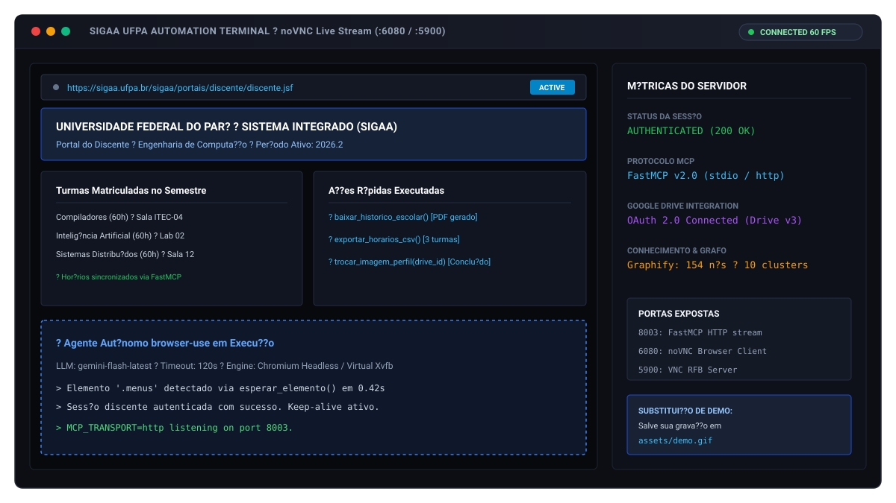
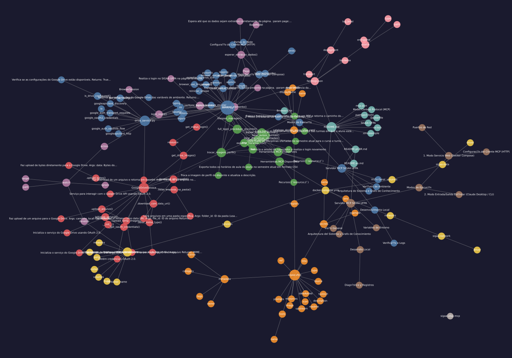

# Servidor MCP SIGAA UFPA

> Servidor Model Context Protocol (MCP) para la automatizaci?n de tr?mites acad?micos en el portal SIGAA de la UFPA mediante `browser-use`, Chromium en Xvfb y Google Drive.

[English](README.md) ? [Portugu?s](README.pt-BR.md) ? [Espa?ol](README.es.md)

---

## Visi?n General


*Guarde su grabaci?n en `assets/demo.gif` para reemplazar esta vista previa.*

`sigaa-ufpa-mcp` proporciona herramientas MCP de alto nivel a clientes de IA (como Claude Desktop, Cursor o LibreChat) para ejecutar operaciones en el sistema SIGAA de la Universidad Federal de Par? (UFPA). Un contenedor Docker aislado ejecuta Chromium sobre una pantalla virtual Xvfb, controlado por `browser-use` y Gemini.

---

## Arquitectura del Sistema y Grafo de Conocimiento

La estructura de la base de c?digo y las relaciones entre m?dulos est?n indexadas con **Graphify** (154 nodos, 192 conexiones, 10 comunidades).



* Los art?culos detallados de arquitectura, flujos de llamadas y nodos clave (*God Nodes*) est?n disponibles en la [Wiki T?cnica de Graphify](graphify-out/wiki/index.md).
* Abra [`graphify-out/graph.html`](graphify-out/graph.html) en cualquier navegador para inspecci?n interactiva de dependencias y filtrado de comunidades.

---

## Herramientas MCP Disponibles

| Herramienta | Par?metros | Retorno | Descripci?n |
| :--- | :--- | :--- | :--- |
| `baixar_historico_escolar` | Ninguno | `dict` | Descarga el expediente acad?mico completo del alumno en formato PDF. |
| `listar_disciplinas_ofertadas` | `curso: str`, `turno: str = ""` | `dict` | Obtiene las asignaturas y grupos abiertos para el periodo lectivo actual por curso y turno. |
| `exportar_horarios_csv` | Ninguno | `dict` | Exporta los horarios de clase del alumno matriculado en formato CSV. |
| `listar_avisos_turmas` | Ninguno | `dict` | Recopila los avisos y comunicados publicados en todos los grupos matriculados. |
| `trocar_imagem_perfil` | `drive_file_id: str`, `descricao: str = ""` | `dict` | Descarga la imagen de Google Drive, valida datos personales (Nacimiento, CPF) y actualiza el perfil en SIGAA. |
| `reiniciar_sessao` | Ninguno | `dict` | Reinicia la instancia de Chromium y vuelve a autenticar la sesi?n en SIGAA (modo HTTP). |

### Recursos (`resource://`)
* `resource://status-init`: Estado de inicializaci?n, mensajes de sesi?n y verificaci?n de inicio de sesi?n activo.
* `resource://drive-images`: Lista metadatos de las im?genes presentes en la carpeta configurada de Google Drive.

---

## Modos de Ejecuci?n

### 1. Modo Servicio Web (Docker Compose)

Mantiene el servidor MCP en segundo plano con supervisi?n gr?fica en tiempo real mediante noVNC y VNC.

```bash
# Clonar el repositorio
git clone https://github.com/joaosnet/sigaa-ufpa-mcp.git
cd sigaa-ufpa-mcp

# Copiar plantilla de entorno y configurar credenciales
cp .env.exemple .env

# Iniciar servicios
docker compose up -d
```

#### Puertos de Red
* **8003**: FastMCP HTTP Stream (`http://localhost:8003/mcp`)
* **6080**: Interfaz noVNC en Navegador (`http://localhost:6080/vnc.html?autoconnect=1&resize=scale&password=browser-use`)
* **5900**: Servidor VNC RFB Nativo (Contrase?a: `browser-use`)

#### Configuraci?n del Cliente MCP (HTTP)
```json
{
  "mcpServers": {
    "sigaa-ufpa": {
      "type": "streamable-http",
      "url": "http://localhost:8003/mcp"
    }
  }
}
```

---

### 2. Modo Entrada/Salida Est?ndar (Claude Desktop / CLI)

Ejecuci?n directa mediante `docker run` usando transporte `stdio`:

```json
{
  "mcpServers": {
    "sigaa-ufpa": {
      "command": "docker",
      "args": [
        "run",
        "--rm",
        "-i",
        "-e", "GOOGLE_API_KEY=SU_CLAVE_GEMINI",
        "-e", "SIGAA_USERNAME=SU_USUARIO_SIGAA",
        "-e", "SIGAA_PASSWORD=SU_CONTRASENA_SIGAA",
        "-e", "MCP_TRANSPORT=stdio",
        "-e", "CHROME_HEADLESS=true",
        "joaosnet/sigaa-ufpa-mcp"
      ]
    }
  }
}
```

---

## Variables de Entorno

| Variable | Obligatoria | Por defecto | Funci?n |
| :--- | :---: | :---: | :--- |
| `GOOGLE_API_KEY` | S? | ? | Clave de API de Google Gemini para la extracci?n visual de elementos mediante `browser-use`. |
| `SIGAA_USERNAME` | S? | ? | Nombre de usuario institucional del discente en SIGAA UFPA. |
| `SIGAA_PASSWORD` | S? | ? | Contrase?a institucional del discente en SIGAA UFPA. |
| `MCP_TRANSPORT` | No | `stdio` | Protocolo de transporte: `stdio` (clientes locales) o `http` (servicio web). |
| `CHROME_HEADLESS` | No | `true` | Ejecuci?n en modo headless de Chromium en el contenedor. |
| `DRIVE_FOLDER_ID` | No | ? | ID de la carpeta de Google Drive con fotos de perfil para sincronizaci?n. |
| `DRIVE_CLIENT_SECRETS_PATH` | No | `client_secrets.json` | Ruta al archivo JSON de credenciales OAuth 2.0. |
| `DRIVE_TOKEN_PATH` | No | `token.json` | Ruta a la cach? de tokens OAuth 2.0. |

---

## Desarrollo Local

```bash
# Instalar dependencias con uv
uv sync --frozen

# Iniciar servidor en modo desarrollo
uv run server.py
```

### Diagn?stico y Registros
* Los registros se canalizan con Loguru a trav?s de la salida est?ndar.
* Acceda a `http://localhost:6080` al usar Docker Compose para visualizar la interacci?n del navegador con SIGAA en tiempo real.
