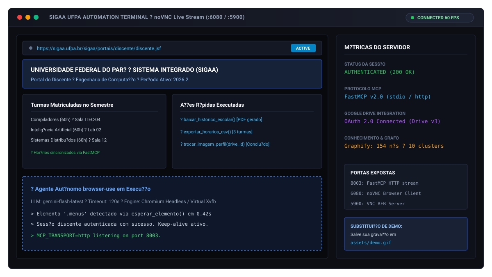
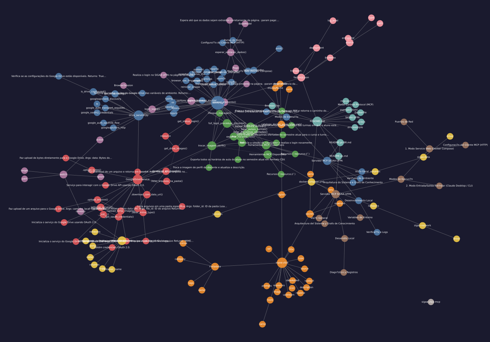

# SIGAA UFPA MCP Server

> Model Context Protocol (MCP) server for automating academic student workflows on the UFPA SIGAA portal using `browser-use`, Chromium in Xvfb, and Google Drive.

[English](README.md) ? [Portugu?s](README.pt-BR.md) ? [Espa?ol](README.es.md)

---

## Overview


*Drop a screen recording at `assets/demo.gif` to replace this preview.*

`sigaa-ufpa-mcp` exposes high-level MCP tools to AI clients (such as Claude Desktop, Cursor, or LibreChat) to execute real-time operations on the Federal University of Par? (UFPA) SIGAA system. An isolated Docker container runs Chromium inside a virtual Xvfb display, controlled by `browser-use` and Gemini.

---

## System Architecture & Knowledge Graph

The codebase structure and module relationships are indexed with **Graphify** (154 nodes, 192 edges, 10 communities).



* Detailed architecture articles, call flows, and God Node breakdowns are available in the [Graphify Knowledge Wiki](graphify-out/wiki/index.md).
* Open [`graphify-out/graph.html`](graphify-out/graph.html) directly in any browser for interactive cluster filtering and dependency inspection.

---

## Exposed MCP Tools

| Tool | Parameters | Return | Description |
| :--- | :--- | :--- | :--- |
| `baixar_historico_escolar` | None | `dict` | Downloads the student's full academic transcript in PDF format. |
| `listar_disciplinas_ofertadas` | `curso: str`, `turno: str = ""` | `dict` | Scrapes all courses offered for the current academic term by course name and shift. |
| `exportar_horarios_csv` | None | `dict` | Extracts active class schedules and student enrollment records into CSV. |
| `listar_avisos_turmas` | None | `dict` | Gathers announcements and notices posted across all enrolled classes. |
| `trocar_imagem_perfil` | `drive_file_id: str`, `descricao: str = ""` | `dict` | Fetches a photo from Google Drive, validates identity (DOB, CPF), and updates SIGAA profile photo. |
| `reiniciar_sessao` | None | `dict` | Restarts the browser instance and re-authenticates the SIGAA session (HTTP mode). |

### Resources (`resource://`)
* `resource://status-init`: Reports startup status, session messages, and whether authentication succeeded.
* `resource://drive-images`: Lists all image metadata found in the configured Google Drive folder.

---

## Deployment Modes

### 1. Web Service Mode (Docker Compose)

Runs the MCP server as a background service with live graphical monitoring via noVNC and VNC.

```bash
# Clone the repository
git clone https://github.com/joaosnet/sigaa-ufpa-mcp.git
cd sigaa-ufpa-mcp

# Copy environment template and fill in credentials
cp .env.exemple .env

# Start services
docker compose up -d
```

#### Network Ports
* **8003**: FastMCP HTTP Stream (`http://localhost:8003/mcp`)
* **6080**: noVNC Browser Interface (`http://localhost:6080/vnc.html?autoconnect=1&resize=scale&password=browser-use`)
* **5900**: Native VNC RFB Server (Password: `browser-use`)

#### MCP Client Configuration (HTTP)
```json
{
  "mcpServers": {
    "sigaa-ufpa": {
      "type": "streamable-http",
      "url": "http://localhost:8003/mcp"
    }
  }
}
```

---

### 2. Standard I/O Mode (Claude Desktop / CLI)

Run directly via `docker run` over `stdio`:

```json
{
  "mcpServers": {
    "sigaa-ufpa": {
      "command": "docker",
      "args": [
        "run",
        "--rm",
        "-i",
        "-e", "GOOGLE_API_KEY=YOUR_GEMINI_KEY",
        "-e", "SIGAA_USERNAME=YOUR_SIGAA_LOGIN",
        "-e", "SIGAA_PASSWORD=YOUR_SIGAA_PASSWORD",
        "-e", "MCP_TRANSPORT=stdio",
        "-e", "CHROME_HEADLESS=true",
        "joaosnet/sigaa-ufpa-mcp"
      ]
    }
  }
}
```

---

## Environment Variables

| Variable | Required | Default | Purpose |
| :--- | :---: | :---: | :--- |
| `GOOGLE_API_KEY` | Yes | ? | Google Gemini API key used by `browser-use` for visual element extraction. |
| `SIGAA_USERNAME` | Yes | ? | UFPA SIGAA student institutional username. |
| `SIGAA_PASSWORD` | Yes | ? | UFPA SIGAA student password. |
| `MCP_TRANSPORT` | No | `stdio` | Transport protocol: `stdio` (CLI clients) or `http` (network daemon). |
| `CHROME_HEADLESS` | No | `true` | Headless execution flag for Chromium inside the container. |
| `DRIVE_FOLDER_ID` | No | ? | Google Drive folder ID containing student photos for profile updates. |
| `DRIVE_CLIENT_SECRETS_PATH` | No | `client_secrets.json` | Path to OAuth 2.0 Client credentials JSON file. |
| `DRIVE_TOKEN_PATH` | No | `token.json` | Path to persisted OAuth 2.0 token cache. |

---

## Local Development

```bash
# Install dependencies with uv
uv sync --frozen

# Start server in development mode
uv run server.py
```

### Verification & Logs
* Logs write to stdout through Loguru and standard handlers.
* Open `http://localhost:6080` while running with Docker Compose to watch the browser automate the login sequence in real time.
