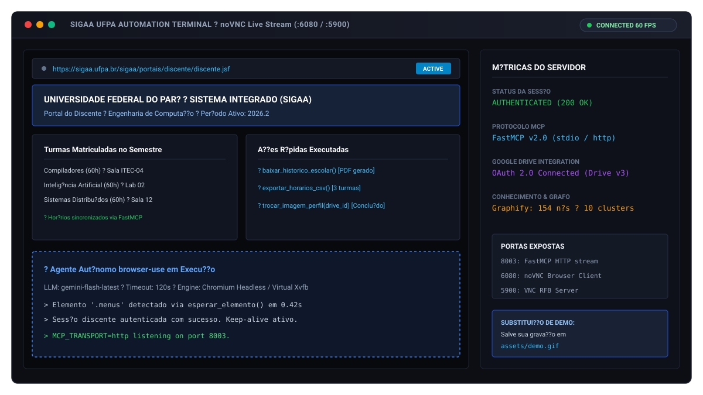
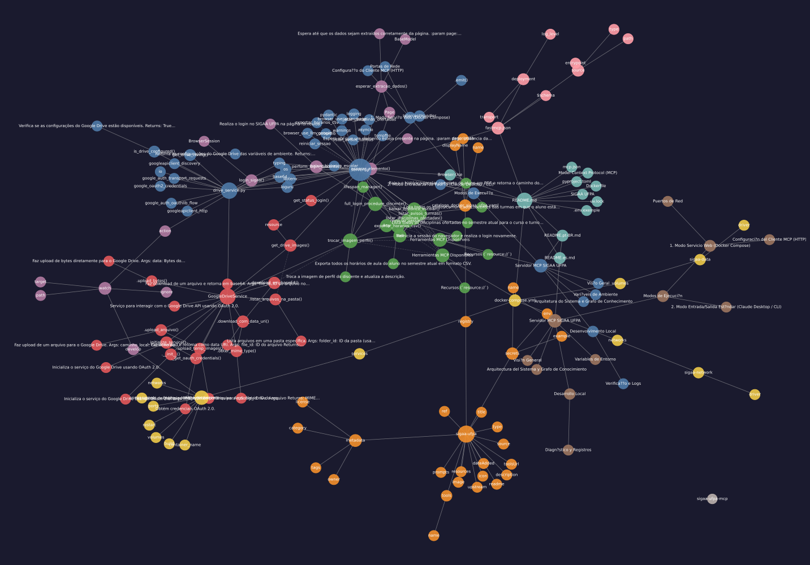

# Servidor MCP SIGAA UFPA

> Servidor Model Context Protocol (MCP) para automa??o de rotinas acad?micas no portal SIGAA da UFPA utilizando `browser-use`, Chromium em Xvfb e Google Drive.

[English](README.md) ? [Portugu?s](README.pt-BR.md) ? [Espa?ol](README.es.md)

---

## Vis?o Geral


*Adicione a grava??o da tela em `assets/demo.gif` para substituir esta pr?via.*

O `sigaa-ufpa-mcp` fornece ferramentas MCP de alto n?vel para clientes de IA (como Claude Desktop, Cursor ou LibreChat) executarem opera??es diretamente no sistema SIGAA da Universidade Federal do Par? (UFPA). Um cont?iner Docker isolado executa o Chromium sob um display virtual Xvfb, controlado por `browser-use` e Gemini.

---

## Arquitetura do Sistema e Grafo de Conhecimento

A estrutura da base de c?digo e os relacionamentos de m?dulos foram mapeados com **Graphify** (154 n?s, 192 conex?es, 10 comunidades).



* Artigos detalhados de arquitetura, fluxos de chamadas e n?s centrais (*God Nodes*) est?o dispon?veis na [Wiki T?cnica do Graphify](graphify-out/wiki/index.md).
* Abra [`graphify-out/graph.html`](graphify-out/graph.html) diretamente em qualquer navegador para navega??o interativa de clusters e inspe??o de depend?ncias.

---

## Ferramentas MCP Dispon?veis

| Ferramenta | Par?metros | Retorno | Descri??o |
| :--- | :--- | :--- | :--- |
| `baixar_historico_escolar` | Nenhum | `dict` | Baixa o hist?rico escolar completo do discente em PDF. |
| `listar_disciplinas_ofertadas` | `curso: str`, `turno: str = ""` | `dict` | Extrai as turmas e disciplinas abertas para o per?odo letivo ativo por curso e turno. |
| `exportar_horarios_csv` | Nenhum | `dict` | Exporta a grade hor?ria das turmas em que o aluno est? matriculado em CSV. |
| `listar_avisos_turmas` | Nenhum | `dict` | Varre os avisos e comunicados postados em todas as turmas ativas do discente. |
| `trocar_imagem_perfil` | `drive_file_id: str`, `descricao: str = ""` | `dict` | Baixa foto do Google Drive, confirma identidade (Data de Nascimento, CPF) e atualiza o perfil no SIGAA. |
| `reiniciar_sessao` | Nenhum | `dict` | Reinicia o Chromium e reautentica a sess?o no SIGAA (modo HTTP). |

### Recursos (`resource://`)
* `resource://status-init`: Retorna status de inicializa??o, mensagens de sess?o e indicador de login ativo.
* `resource://drive-images`: Lista metadados de todas as imagens presentes na pasta configurada do Google Drive.

---

## Modos de Execu??o

### 1. Modo Servi?o Web (Docker Compose)

Mant?m o servidor MCP em execu??o cont?nua com monitoramento gr?fico em tempo real via noVNC e VNC.

```bash
# Clone o reposit?rio
git clone https://github.com/joaosnet/sigaa-ufpa-mcp.git
cd sigaa-ufpa-mcp

# Copie o arquivo de exemplo e preencha as credenciais
cp .env.exemple .env

# Inicie os servi?os
docker compose up -d
```

#### Portas de Rede
* **8003**: FastMCP HTTP Stream (`http://localhost:8003/mcp`)
* **6080**: Interface noVNC no Navegador (`http://localhost:6080/vnc.html?autoconnect=1&resize=scale&password=browser-use`)
* **5900**: Servidor VNC RFB Nativo (Senha: `browser-use`)

#### Configura??o do Cliente MCP (HTTP)
```json
{
  "mcpServers": {
    "sigaa-ufpa": {
      "type": "streamable-http",
      "url": "http://localhost:8003/mcp"
    }
  }
}
```

---

### 2. Modo Entrada/Sa?da Padr?o (Claude Desktop / CLI)

Execu??o direta via `docker run` usando transporte `stdio`:

```json
{
  "mcpServers": {
    "sigaa-ufpa": {
      "command": "docker",
      "args": [
        "run",
        "--rm",
        "-i",
        "-e", "GOOGLE_API_KEY=SUA_CHAVE_GEMINI",
        "-e", "SIGAA_USERNAME=SEU_LOGIN_SIGAA",
        "-e", "SIGAA_PASSWORD=SUA_SENHA_SIGAA",
        "-e", "MCP_TRANSPORT=stdio",
        "-e", "CHROME_HEADLESS=true",
        "joaosnet/sigaa-ufpa-mcp"
      ]
    }
  }
}
```

---

## Vari?veis de Ambiente

| Vari?vel | Obrigat?ria | Padr?o | Finalidade |
| :--- | :---: | :---: | :--- |
| `GOOGLE_API_KEY` | Sim | ? | Chave de API Google Gemini utilizada pelo `browser-use` para extra??o de dados da tela. |
| `SIGAA_USERNAME` | Sim | ? | Nome de usu?rio institucional do discente no SIGAA UFPA. |
| `SIGAA_PASSWORD` | Sim | ? | Senha de acesso do discente no SIGAA UFPA. |
| `MCP_TRANSPORT` | N?o | `stdio` | Protocolo de transporte: `stdio` (clientes locais) ou `http` (servi?o web). |
| `CHROME_HEADLESS` | N?o | `true` | Execu??o sem cabe?a do Chromium no cont?iner. |
| `DRIVE_FOLDER_ID` | N?o | ? | Identificador da pasta do Google Drive com as imagens para sincroniza??o. |
| `DRIVE_CLIENT_SECRETS_PATH` | N?o | `client_secrets.json` | Caminho para o JSON de credenciais OAuth 2.0. |
| `DRIVE_TOKEN_PATH` | N?o | `token.json` | Caminho para o cache de token OAuth 2.0. |

---

## Desenvolvimento Local

```bash
# Instalar depend?ncias com uv
uv sync --frozen

# Executar o servidor em modo desenvolvimento
uv run server.py
```

### Verifica??o e Logs
* Os logs s?o emitidos via Loguru e interceptadores de sa?da padr?o.
* Acesse `http://localhost:6080` ao executar com Docker Compose para acompanhar o navegador executando o login em tempo real.
