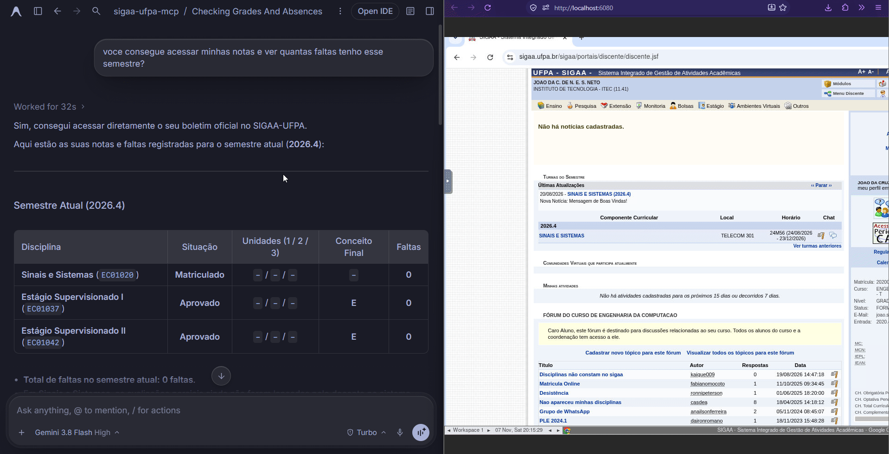

# SIGAA UFPA MCP

<p align="center">
  <strong>Servidor MCP e Aplicativos Interativos para o Portal SIGAA da UFPA</strong><br/>
  FastMCP 4.1 · Prefab UI · Playwright · Zero Gasto de Tokens de Outra IA
</p>

<p align="center">
  <a href="README.md">English</a> ·
  <a href="README.pt-BR.md"><strong>Português (Brasil)</strong></a> ·
  <a href="README.es.md">Español</a>
</p>

<p align="center">
  
</p>

Conecta clientes MCP (**Google Antigravity**, **Claude Desktop**, **Cursor**, **VS Code**) diretamente ao [sigaa.ufpa.br](https://sigaa.ufpa.br) com automação determinística via Playwright, painéis interativos `prefab-ui` e Login Visual isolado em memória RAM.

---

## Instalação Rápida (Docker Compose)

Não é necessário criar arquivo `.env`. Na raiz do repositório, execute:

```bash
docker compose up -d --build
```

- **Endpoint MCP HTTP:** `http://localhost:8003/mcp`
- **Portal de Login Visual:** `http://localhost:8003/login` *(ou chame `abrir_login_sigaa` direto no chat)*
- **Navegador ao Vivo (noVNC):** `http://localhost:6080` *(senha padrão: `sigaa`)*

### Cadastrar no Cliente MCP (`mcp_config.json`)

**Sob demanda (inicia apenas quando solicitado via Docker):**
```json
{
  "mcpServers": {
    "sigaa-ufpa": {
      "command": "docker",
      "args": [
        "run", "-i", "--rm",
        "--entrypoint", "/app/.venv/bin/python",
        "--env-file", "/caminho/absoluto/para/sigaa-ufpa-mcp/.env",
        "-e", "MCP_TRANSPORT=stdio",
        "-e", "CHROME_HEADLESS=true",
        "-v", "/caminho/absoluto/para/sigaa-ufpa-mcp/downloads:/app/downloads",
        "-v", "/caminho/absoluto/para/sigaa-ufpa-mcp/.sigaa_state:/app/.sigaa_state",
        "sigaa-ufpa-mcp:latest",
        "/app/server.py"
      ]
    }
  }
}
```

*Ou utilize `"url": "http://localhost:8003/mcp"` caso execute `docker compose up -d` de forma contínua.*

---

## Instalação Local (Sem Docker)

Requer **Python 3.12+** e [`uv`](https://docs.astral.sh/uv/):

```bash
uv sync
uv run playwright install chromium

# Opção A: Servidor HTTP em http://localhost:8003/mcp
MCP_TRANSPORT=http uv run server.py

# Opção B: Servidor stdio para clientes desktop locais
uv run server.py
```

<details>
<summary><strong>Configuração local via <code>stdio</code> (Claude Desktop / Cursor)</strong></summary>

```json
{
  "mcpServers": {
    "sigaa-ufpa": {
      "command": "uv",
      "args": ["--directory", "/caminho/absoluto/para/sigaa-ufpa-mcp", "run", "server.py"],
      "env": {
        "MCP_TRANSPORT": "stdio",
        "CHROME_HEADLESS": "true"
      }
    }
  }
}
```
</details>

---

## Documentação Completa

Todos os detalhes técnicos, catálogo de tools, códigos de horário da UFPA e configurações avançadas estão em [`docs/`](docs/README.md):

- [Guia Técnico Completo em Português](docs/pt-BR.md)
- [Architecture & Security (EN)](docs/architecture.md) · [Apps, Tools & Prompts (EN)](docs/tools-and-apps.md) · [Configuration & Drive (EN)](docs/configuration.md)

## Licença

[MIT](pyproject.toml)
