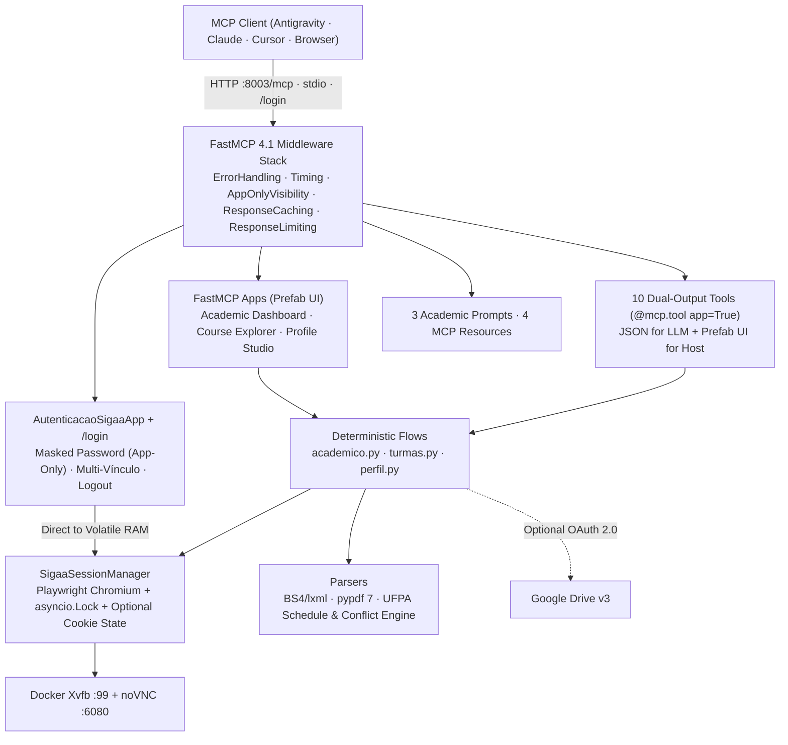

# Architecture, Security & Testing

[← Back to README](../README.md) · [Português](pt-BR.md) · [Español](es.md)

## Deterministic Zero-Token Engine

`sigaa-ufpa-mcp` automates the [UFPA SIGAA portal](https://sigaa.ufpa.br) with deterministic Playwright selectors, direct JSF `_cmItemList` form submissions, `BeautifulSoup4`/`lxml` HTML parsers, and `pypdf` 7 PDF text extraction. The server makes zero calls to external LLM APIs.



## Visual Login & Password Isolation

1. **App-Only Credentials (`visibility=["app"]`):** The `abrir_login_sigaa` app renders a masked password field (`input_type="password"`). Submitting the form triggers `autenticar_credenciais_ui`, registered with `@auth_app.tool(model=False)` and filtered by `AppOnlyVisibilityMiddleware`. Your password goes directly from the UI to Python's volatile RAM and never appears in `tools/list` schemas, chat history, or LLM context windows.
2. **Local Web Portal (`/login`):** For clients without MCP Apps UI support, `http://localhost:8003/login` provides a CSRF-protected local form (`HttpOnly`, `SameSite=Strict` cookie), light/dark theme support, multi-vínculo selection, and one-click logout.
3. **Auto-Prompt When Logged Out:** Calling any protected academic tool without an active session returns the visual login card and the `/login` fallback URL instead of failing with an unhandled exception.
4. **Cookie-Only Persistence:** Enabling *"Keep session active"* saves only Playwright browser cookies to `.sigaa_state/storage_state.json` (mode `0600`). Passwords are never written to disk.
5. **Stdio Purity:** All runtime logs go strictly to `sys.stderr`, keeping `stdout` reserved for JSON-RPC frames in `stdio` transport.

## Package Layout

- `server.py` — FastMCP 4.1 entrypoint, middleware stack, cache invalidation hooks, and `stdio`/`http` runner.
- `sigaa_mcp/session.py` — `SigaaSessionManager` (`asyncio.Lock`, Chromium lifecycle, volatile RAM credentials, CDP `Page.printToPDF`).
- `sigaa_mcp/auth.py` — Login flow, intermediate screen bypass, multi-vínculo selection, JSF menu navigation, and logout.
- `sigaa_mcp/parsers.py` — UFPA schedule decoder, conflict detector, BS4/lxml HTML scrapers, and `pypdf` 7 transcript parser.
- `sigaa_mcp/flows/` — Academic (`academico.py`), class/AVA (`turmas.py`), and profile (`perfil.py`) workflows.
- `sigaa_mcp/apps/` — `AutenticacaoSigaaApp`, `PainelAcademicoApp`, `ExploradorTurmasApp`, and `PerfilDiscenteApp`.
- `sigaa_mcp/web_login.py` — `/login`, `/login/vinculo`, `/logout`, and `/health` HTTP routes.

## Running Tests

```bash
uv run pytest -v
```

The test suite covers UFPA schedule decoding, timetable conflict detection, HTML/PDF parsers, `AppOnlyVisibilityMiddleware` password isolation, CSRF validation on `/login`, cache invalidation on session changes, and path-traversal guards on `resource://downloads/{filename}`.
