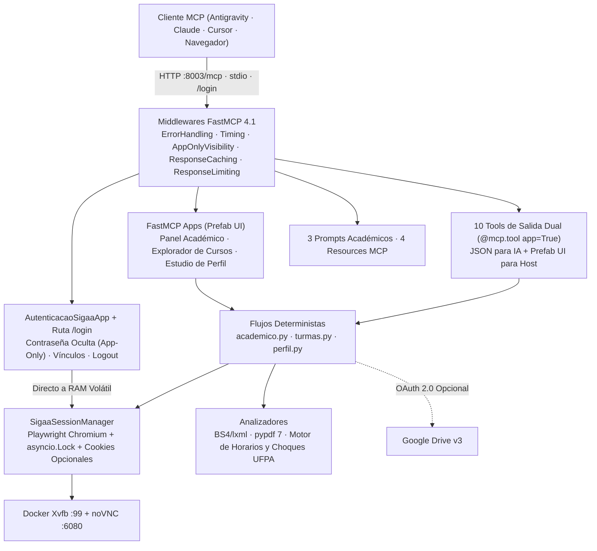

# Documentación Técnica — SIGAA UFPA MCP

[← Volver al README](../README.es.md) · [English](README.md) · [Português](pt-BR.md)

## Arquitectura Determinista (Cero Tokens Externos)

El servidor interactúa con el [portal SIGAA de la UFPA](https://sigaa.ufpa.br) mediante selectores deterministas de Playwright, envío directo de formularios JSF (`_cmItemList`), analizadores HTML `BeautifulSoup4`/`lxml` y extracción de PDF con `pypdf` 7. No requiere claves de API de LLM externas.



### Seguridad del Inicio de Sesión Visual

- **Aislamiento de Contraseña (`visibility=["app"]`):** El campo `input_type="password"` en `abrir_login_sigaa` invoca `autenticar_credenciais_ui` (`model=False`), filtrado por `AppOnlyVisibilityMiddleware`. La contraseña viaja directamente a la RAM volátil de Python sin pasar por el chat ni por el LLM.
- **Portal Local (`/login`):** Disponible en `http://localhost:8003/login` con protección CSRF (`HttpOnly`, `SameSite=Strict`), modo claro/oscuro, selección de múltiples vínculos y cierre de sesión.
- **Persistencia Opcional por Cookies:** La opción *"Mantener sesión activa"* guarda solo cookies en `.sigaa_state/storage_state.json` (`0600`), nunca contraseñas en disco.

---

## 4 Aplicaciones Interactivas (`FastMCPApp`)

| Aplicación | Tool de Entrada | Función |
| :--- | :--- | :--- |
| `AutenticacaoSigaaApp` | `abrir_login_sigaa` | Inicio de sesión con contraseña oculta, selector de vínculos, persistencia opcional de cookies y logout. Se abre automáticamente si se llama una herramienta sin sesión activa. |
| `PainelAcademicoApp` | `abrir_painel_academico` | Panel en pestañas con índices (`CRG`, `MC`, `IEA`), materias actuales, calificaciones/faltas filtrables, avisos y descarga en 1 clic de Historial y Certificado en PDF. |
| `ExploradorTurmasApp` | `abrir_explorador_turmas` | Búsqueda de cursos ofertados por carrera y turno (`M`/`T`/`N`) con detección automática de choques de horario y exportación CSV. |
| `PerfilDiscenteApp` | `abrir_estudio_perfil` | Validación, simulación segura (`dry_run=True`) o cambio de foto (archivo local, URL HTTPS o Google Drive) y descripción personal. |

---

## 10 Herramientas, 3 Prompts y 4 Recursos

Todas las herramientas devuelven `ToolResult` dual: JSON UTF-8 en `content[0].text` para el modelo y vista interactiva `Prefab` en `structured_content`.

| Herramienta | Seguridad | Descripción |
| :--- | :---: | :--- |
| `baixar_historico_escolar(enviar_drive=False)` | Lectura | Descarga el PDF oficial del Historial Académico y extrae `CRG`, `MC`, `IEA`, carga horaria y obligatorias pendientes. |
| `emitir_atestado_matricula(enviar_drive=False)` | Lectura | Emite el Certificado de Matrícula (con soporte para período suplementario), guarda PDF vía CDP y extrae materias + código de verificación. |
| `consultar_notas_frequencia(semestre=None)` | Lectura | Consulta conceptos oficiales UFPA (`E`, `B`, `R`, `I`, `S`), notas parciales, faltas y estado por semestre. |
| `listar_atividades_pendentes(incluir_concluidas=False)` | Lectura | Revisa el Portal del Estudiante y el AVA de cada materia buscando tareas, cuestionarios y exámenes. |
| `exportar_horarios_csv(enviar_drive=False)` | Lectura | Decodifica horarios UFPA en bloques de 50 min, verifica solapamientos y guarda CSV UTF-8 en `./downloads`. |
| `listar_avisos_turmas(disciplina_filtro=None, limite_por_turma=5)` | Lectura | Recopila anuncios docentes publicados en el portal y en el AVA. |
| `listar_disciplinas_ofertadas(curso, turno=None, ano=None, periodo=None)` | Lectura | Busca materias ofertadas en la UFPA y marca choques con su horario matriculado. |
| `trocar_imagem_perfil(drive_file_id=None, caminho_ou_url=None, descricao=None, dry_run=False)` | Escritura | Actualiza (o simula con `dry_run=True`) foto y biografía leyendo datos de confirmación únicamente en RAM. |
| `reiniciar_sessao()` | Idempotente | Reinicia el contexto de Chromium, limpia la caché y revalida la sesión activa. |
| `encerrar_sessao()` | Destructiva | Cierra sesión en SIGAA, limpia credenciales en RAM, elimina `.sigaa_state/storage_state.json` y purga la caché. |

### Prompts Académicos
- `planejar_matricula_semestre(curso, turno_preferido="")` — Cruza obligatorias pendientes con grupos ofertados sin choque de horario.
- `briefing_semana_academica()` — Resume entregas abiertas, avisos docentes y faltas ordenados por fecha límite.
- `auditar_integralizacao_curricular()` — Audita créditos aprobados frente a exigidos y requisitos restantes de graduación.

### Recursos MCP
- `resource://status-init` — Estado de sesión, vínculo activo, persistencia y Google Drive.
- `resource://drive-images` — Lista imágenes disponibles en la carpeta opcional de Google Drive.
- `resource://downloads` — Lista archivos PDF y CSV generados en `./downloads`.
- `resource://downloads/{filename}` — Lee CSV (UTF-8) o PDF (base64 + metadatos) con protección contra *path traversal*.

---

## Códigos de Horario UFPA

Formato `<Días><Turno><Bloques>` (ej.: `24M56` = Lunes y Miércoles, Mañana, bloques 5 y 6 -> `11:10–12:50`):

- **Días:** `2` Lun · `3` Mar · `4` Mié · `5` Jue · `6` Vie · `7` Sáb
- **Mañana (`M`):** `1` 07:30–08:20 · `2` 08:20–09:10 · `3` 09:20–10:10 · `4` 10:10–11:00 · `5` 11:10–12:00 · `6` 12:00–12:50
- **Tarde (`T`):** `1` 13:00–13:50 · `2` 13:50–14:40 · `3` 14:50–15:40 · `4` 15:40–16:30 · `5` 16:40–17:30 · `6` 17:30–18:20
- **Noche (`N`):** `1` 18:30–19:20 · `2` 19:20–20:10 · `3` 20:10–21:00 · `4` 21:00–21:50

---

## Variables Opcionales (`.env`) y Pruebas

Copie `.env.example` a `.env` solo si desea inicio de sesión automático desatendido o integración con Google Drive:

| Variable | Por defecto | Descripción |
| :--- | :--- | :--- |
| `SIGAA_USERNAME` / `SIGAA_PASSWORD` | *(vacíos)* | Credenciales opcionales (dejar vacías para usar Login Visual) |
| `SIGAA_MATRICULA` | *(vacío)* | Matrícula preferida cuando existen múltiples vínculos |
| `MCP_TRANSPORT` | `stdio` | `stdio` (escritorio) o `http` (Docker / URL) |
| `MCP_SERVER_PORT` | `8003` | Puerto HTTP para `/mcp`, `/login` y `/health` |
| `CHROME_HEADLESS` | `true` (`false` en Docker) | Sin ventana localmente o visible vía noVNC en Docker |
| `VNC_PASSWORD` | `sigaa` | Contraseña de noVNC (`:6080`) y x11vnc (`:5900`) en Docker |
| `DRIVE_FOLDER_ID` | *(vacío)* | ID opcional de carpeta en Google Drive |

Ejecutar pruebas automatizadas:

```bash
uv run pytest -v
```
