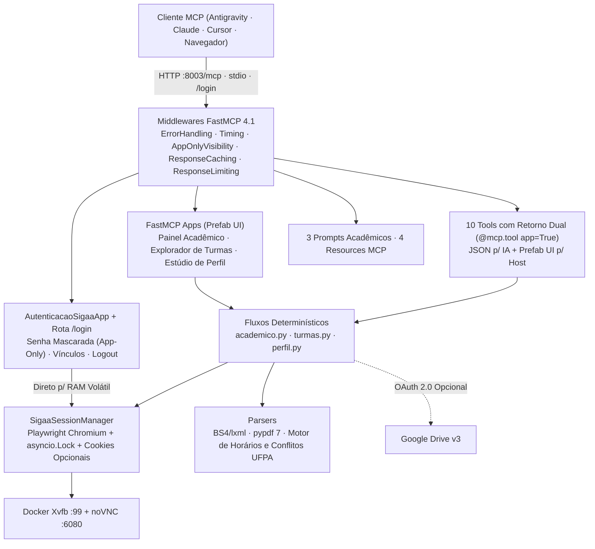

# Documentação Técnica — SIGAA UFPA MCP

[← Voltar ao README](../README.pt-BR.md) · [English](README.md) · [Español](es.md)

## Arquitetura Determinística (Zero Tokens Externos)

O servidor navega no [SIGAA da UFPA](https://sigaa.ufpa.br) usando seletores determinísticos do Playwright, submissão direta de formulários JSF (`_cmItemList`), parsers HTML `BeautifulSoup4`/`lxml` e extração de PDF com `pypdf` 7. Nenhuma chave de API de LLM externa é usada.



### Segurança do Login Visual

- **Isolamento da Senha (`visibility=["app"]`):** O campo `input_type="password"` em `abrir_login_sigaa` chama `autenticar_credenciais_ui` (`model=False`), filtrado por `AppOnlyVisibilityMiddleware`. A senha vai direto da interface para a RAM do servidor Python e nunca entra no chat ou no contexto do LLM.
- **Portal Local (`/login`):** Disponível em `http://localhost:8003/login` com proteção CSRF (`HttpOnly`, `SameSite=Strict`), tema claro/escuro automático, seleção de múltiplos vínculos e botão de logout.
- **Persistência Opcional por Cookies:** A opção *"Manter sessão ativa"* grava apenas cookies de navegador em `.sigaa_state/storage_state.json` (`0600`), sem salvar senhas em disco.

---

## 4 Aplicativos Interativos (`FastMCPApp`)

| Aplicativo | Tool de Entrada | Função |
| :--- | :--- | :--- |
| `AutenticacaoSigaaApp` | `abrir_login_sigaa` | Login com senha mascarada, escolha de vínculo, opção de manter sessão por cookies e logout. Retornado automaticamente se qualquer tool for chamada sem sessão ativa. |
| `PainelAcademicoApp` | `abrir_painel_academico` | Abas com índices (`CRG`, `MC`, `IEA`), turmas do semestre, boletim filtrável de notas/faltas, avisos e emissão em 1 clique de Histórico e Atestado em PDF. |
| `ExploradorTurmasApp` | `abrir_explorador_turmas` | Busca de ofertas por curso e turno (`M`/`T`/`N`) com detecção automática de choque de horário contra sua grade atual e exportação CSV. |
| `PerfilDiscenteApp` | `abrir_estudio_perfil` | Validação, simulação segura (`dry_run=True`) ou troca da foto (arquivo local, URL HTTPS ou Google Drive) e descrição pessoal. |

---

## 10 Tools, 3 Prompts e 4 Resources

Todas as 10 tools retornam `ToolResult` dual: JSON UTF-8 estruturado em `content[0].text` para o modelo e interface `Prefab` em `structured_content`.

| Tool | Segurança | Descrição |
| :--- | :---: | :--- |
| `baixar_historico_escolar(enviar_drive=False)` | Leitura | Baixa o PDF oficial do Histórico Escolar e extrai `CRG`, `MC`, `IEA`, carga horária e obrigatórias pendentes. |
| `emitir_atestado_matricula(enviar_drive=False)` | Leitura | Emite o Atestado de Matrícula (com fallback para Período Suplementar), salva PDF via CDP e extrai turmas + código de verificação. |
| `consultar_notas_frequencia(semestre=None)` | Leitura | Extrai conceitos UFPA (`E`, `B`, `R`, `I`, `S`), avaliações parciais, faltas e situação por semestre. |
| `listar_atividades_pendentes(incluir_concluidas=False)` | Leitura | Varre o Portal do Discente e o AVA de cada turma matriculada buscando tarefas, questionários e provas. |
| `exportar_horarios_csv(enviar_drive=False)` | Leitura | Decodifica horários UFPA em faixas de 50 min, checa conflitos e gera CSV UTF-8 em `./downloads`. |
| `listar_avisos_turmas(disciplina_filtro=None, limite_por_turma=5)` | Leitura | Coleta notícias e comunicados recentes no portal e nas salas virtuais (AVA). |
| `listar_disciplinas_ofertadas(curso, turno=None, ano=None, periodo=None)` | Leitura | Pesquisa turmas ofertadas na UFPA e aponta choques com sua grade atual. |
| `trocar_imagem_perfil(drive_file_id=None, caminho_ou_url=None, descricao=None, dry_run=False)` | Escrita | Atualiza (ou simula com `dry_run=True`) foto e descrição do perfil lendo campos de confirmação apenas em RAM. |
| `reiniciar_sessao()` | Idempotente | Reinicia o contexto Chromium, limpa o cache temporário e revalida a sessão. |
| `encerrar_sessao()` | Destrutiva | Faz logoff no SIGAA, apaga credenciais da RAM, remove `.sigaa_state/storage_state.json` e limpa o cache. |

### Prompts Acadêmicos
- `planejar_matricula_semestre(curso, turno_preferido="")` — Cruza obrigatórias pendentes do histórico com turmas ofertadas sem choque.
- `briefing_semana_academica()` — Resume pendências, avisos docentes e faltas por prioridade de prazo.
- `auditar_integralizacao_curricular()` — Analisa carga horária cumprida vs. exigida e requisitos restantes para colação.

### Resources MCP
- `resource://status-init` — Estado da autenticação, vínculo ativo, persistência e status do Drive.
- `resource://drive-images` — Lista imagens na pasta opcional do Google Drive.
- `resource://downloads` — Lista PDFs e CSVs gerados em `./downloads`.
- `resource://downloads/{filename}` — Lê CSV (UTF-8) ou PDF (base64 + metadados) com proteção contra *path traversal*.

---

## Códigos de Horário da UFPA

Formato `<Dias><Turno><Blocos>` (ex.: `24M56` = Segunda e Quarta, Manhã, blocos 5 e 6 -> `11:10–12:50`):

- **Dias:** `2` Seg · `3` Ter · `4` Qua · `5` Qui · `6` Sex · `7` Sáb
- **Manhã (`M`):** `1` 07:30–08:20 · `2` 08:20–09:10 · `3` 09:20–10:10 · `4` 10:10–11:00 · `5` 11:10–12:00 · `6` 12:00–12:50
- **Tarde (`T`):** `1` 13:00–13:50 · `2` 13:50–14:40 · `3` 14:50–15:40 · `4` 15:40–16:30 · `5` 16:40–17:30 · `6` 17:30–18:20
- **Noite (`N`):** `1` 18:30–19:20 · `2` 19:20–20:10 · `3` 20:10–21:00 · `4` 21:00–21:50

---

## Variáveis Opcionais (`.env`) e Testes

Copie `.env.example` para `.env` apenas se desejar login automático desassistido ou upload para Google Drive:

| Variável | Padrão | Descrição |
| :--- | :--- | :--- |
| `SIGAA_USERNAME` / `SIGAA_PASSWORD` | *(vazios)* | Credenciais opcionais (deixe vazias para usar o Login Visual) |
| `SIGAA_MATRICULA` | *(vazio)* | Matrícula preferencial quando houver múltiplos vínculos |
| `MCP_TRANSPORT` | `stdio` | `stdio` (clientes locais) ou `http` (Docker / URL) |
| `MCP_SERVER_PORT` | `8003` | Porta HTTP para `/mcp`, `/login` e `/health` |
| `CHROME_HEADLESS` | `true` (`false` no Docker) | Execução sem janela localmente ou visível via noVNC no Docker |
| `VNC_PASSWORD` | `sigaa` | Senha do noVNC (`:6080`) e x11vnc (`:5900`) no Docker |
| `DRIVE_FOLDER_ID` | *(vazio)* | ID opcional da pasta no Google Drive |

Para rodar a suíte de testes automatizados:

```bash
uv run pytest -v
```
