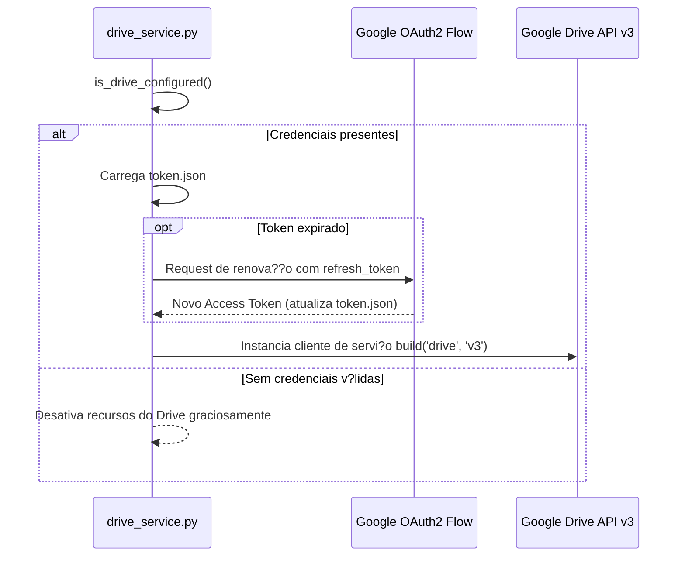

# Configura??o de Autentica??o do Google Drive

> **Comunidade 0** ? 32 n?s ? Coes?o: 0.07 ? Fonte prim?ria: `drive_service.py`

## Vis?o Geral
Esta comunidade agrupa as rotinas e valida??es de credenciais OAuth 2.0 necess?rias para conceder acesso ?s APIs do Google Workspace.

---

## ?? Fluxo de Autentica??o OAuth 2.0

### Fun??es Utilit?rias
* `is_drive_configured() -> bool`: Retorna `True` apenas se o arquivo de segredos existir e o `DRIVE_FOLDER_ID` estiver definido no ambiente.
* `get_drive_config() -> tuple`: L? os caminhos configurados nas vari?veis de ambiente.
* `InterceptHandler`: Interceptador de logs para canalizar sa?das de bibliotecas padr?o (`googleapiclient`) para a formata??o estruturada do Loguru.
