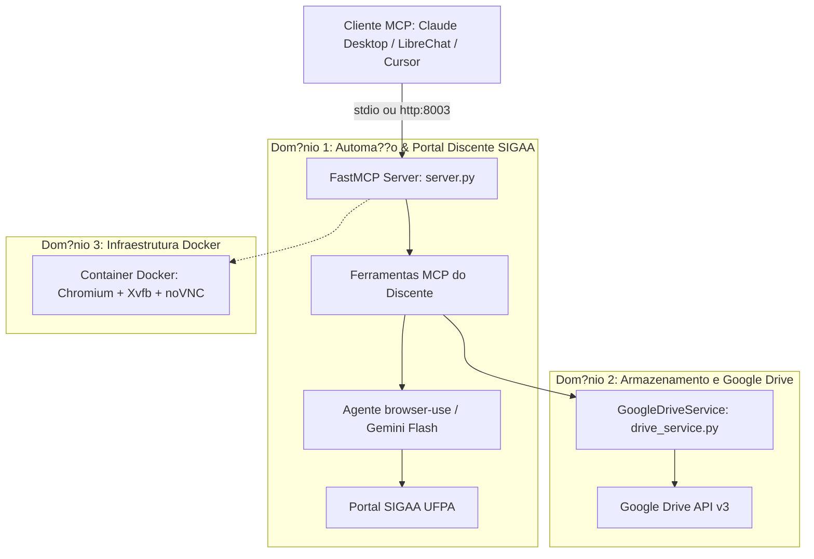

# ?ndice Geral da Wiki T?cnica - SIGAA UFPA MCP

> Base de conhecimento arquitetural e operacional gerada via **Graphify**.
> Destinada a desenvolvedores, engenheiros de automa??o e agentes aut?nomos (LLM).

**M?tricas do Grafo:** 154 n?s ? 192 conex?es ? 10 comunidades mapeadas

---

## ??? Matriz de Dom?nios e Arquitetura

O ecossistema **SIGAA UFPA MCP** conecta o Modelo de Contexto de Protocolo (FastMCP) ao portal acad?mico SIGAA da UFPA utilizando automa??o de navegador via **browser-use** (Chromium) e integra??o com a nuvem do **Google Drive**.

---

## ?? Comunidades e M?dulos T?cnicos

### 1. Dom?nio SIGAA: Automa??o e Servi?os Discente
- [Servi?os do Portal Discente SIGAA](Servicos_do_Portal_Discente_SIGAA.md) ? As 6 ferramentas FastMCP centrais (hist?rico, disciplinas, hor?rios, avisos, fotos e sess?o).
- [Automa??o Web do SIGAA](Automacao_Web_do_SIGAA.md) ? Rotinas de espera din?mica de DOM, inje??o de credenciais e procedimentos de autentica??o.
- [Sistema de Gest?o Acad?mica UFPA](Sistema_de_Gestao_Academica_UFPA.md) ? Regras de neg?cio, restri??es sazonais (processamento de matr?cula) e URLs p?blicas de consulta.

### 2. Dom?nio Google Drive: Integra??o e Armazenamento
- [Integra??o com Google Drive](Integracao_com_Google_Drive.md) ? Mecanismo de download em base64, listagem de imagens na pasta remota e arquivos tempor?rios.
- [Configura??o de Autentica??o do Google Drive](Configuracao_de_Autenticacao_do_Google_Drive.md) ? OAuth 2.0, refresh tokens (`token.json`), client secrets e credenciais de servi?o.

### 3. Dom?nio Infraestrutura: Docker, VNC e FastMCP
- [Infraestrutura de Automa??o de Navegador em Docker](Infraestrutura_de_Automacao_de_Navegador_em_Docker.md) ? Display virtual Xvfb, interface web noVNC (porta 6080) e servidor VNC (porta 5900).
- [Configura??o do Docker Compose](Configuracao_do_Docker_Compose.md) ? Mapeamento de volumes (`sigaa-data`), redes isoladas, pol?ticas de restart e portas expostas.
- [Configura??o de Implanta??o FastMCP](Configuracao_de_Implantacao_FastMCP.md) ? Ciclo de vida (`lifespan_manager`), transportes (`stdio` vs `http`) e recursos expostos (`resource://`).
- [Metadados do Cat?logo Docker](Metadados_do_Catalogo_Docker.md) ? Especifica??o do cont?iner para cat?logos Docker e compatibilidade MCP.
- [Metadados de Recursos](Metadados_de_Recursos.md) ? Categorias, licenciamento e metadados de empacotamento.

---

## ?? God Nodes (Abstra??es Centrais de Carga)

Estes n?s possuem a maior centralidade e volume de conex?es no sistema:

| God Node | Conex?es | Papel no Sistema | Arquivo Fonte |
| :--- | :---: | :--- | :--- |
| [`sigaa-ufpa`](sigaa-ufpa.md) | 17 | Identificador do servi?o raiz e defini??es de dom?nio do sistema | `catalogo_docker_sigaa_ufpa.yaml` / `server.py` |
| [`GoogleDriveService`](GoogleDriveService.md) | 14 | Gerenciador de conex?o OAuth2, download/upload de bin?rios e fotos | `drive_service.py` |
| [`sigaa-mcp-server`](sigaa-mcp-server.md) | 9 | Defini??o de servi?o central do cont?iner Docker Compose | `docker-compose.yml` |
| [`full_login_procedure_discente()`](full_login_procedure_discente.md) | 9 | Procedimento global de autentica??o de sess?o e abertura do menu discente | `server.py` |
| [`trocar_imagem_perfil()`](trocar_imagem_perfil.md) | 8 | Orquestra??o multiagente mais complexa: extra??o de CPF/nascimento, Drive e SIGAA | `server.py` |
| [`esperar_elemento()`](esperar_elemento.md) | 5 | Primitiva ass?ncrona com polling e retry para toler?ncia a lentid?o do SIGAA | `server.py` |
| [`perform_login_discente()`](perform_login_discente.md) | 5 | Inje??o de credenciais nos seletores de formul?rio do SIGAA | `server.py` |
| [`reiniciar_sessao()`](reiniciar_sessao.md) | 5 | Ferramenta de autocura do navegador quando a sess?o web expira | `server.py` |

---

## ?? Guia Operacional para Agentes Aut?nomos (LLM)

Ao interagir com o servidor MCP:
1. **Verifica??o de Inicializa??o:** Consulte o recurso `resource://status-init` para validar se a sess?o do SIGAA foi logada com ?xito.
2. **Resili?ncia a Desconex?o:** Se qualquer ferramenta falhar com erro de autentica??o ou seletor n?o encontrado, execute `reiniciar_sessao` imediatamente.
3. **Prazos e Timeouts:** O SIGAA possui tempos de resposta lentos em hor?rios de pico. As ferramentas de automa??o usam timeouts de 90s a 120s por etapa; garanta que o cliente MCP esteja configurado com timeout de pelo menos `1800s`.
4. **Vari?veis Obrigat?rias:** Verifique a presen?a de `GOOGLE_API_KEY`, `SIGAA_USERNAME`, `SIGAA_PASSWORD` e credenciais Google Drive se a manipula??o de imagens for requisitada.
