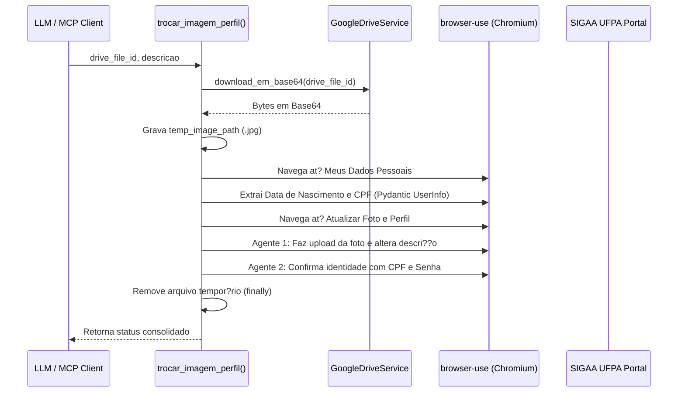

# trocar_imagem_perfil()

> **God Node** ? 8 conex?es ? Fonte: `server.py`
> **Comunidade:** [Servi?os do Portal Discente SIGAA](Servicos_do_Portal_Discente_SIGAA.md)

## Descri??o Arquitetural
Esta ? a ferramenta de maior complexidade orquestral do servidor MCP. Ela conecta o reposit?rio de arquivos do Google Drive, a extra??o estruturada de dados sens?veis no SIGAA e a confirma??o em duas etapas exigida pela UFPA.

## Fluxo de Execu??o

---
*Parte da Wiki de Conhecimento do Graphify. Veja o [?ndice](index.md).*
